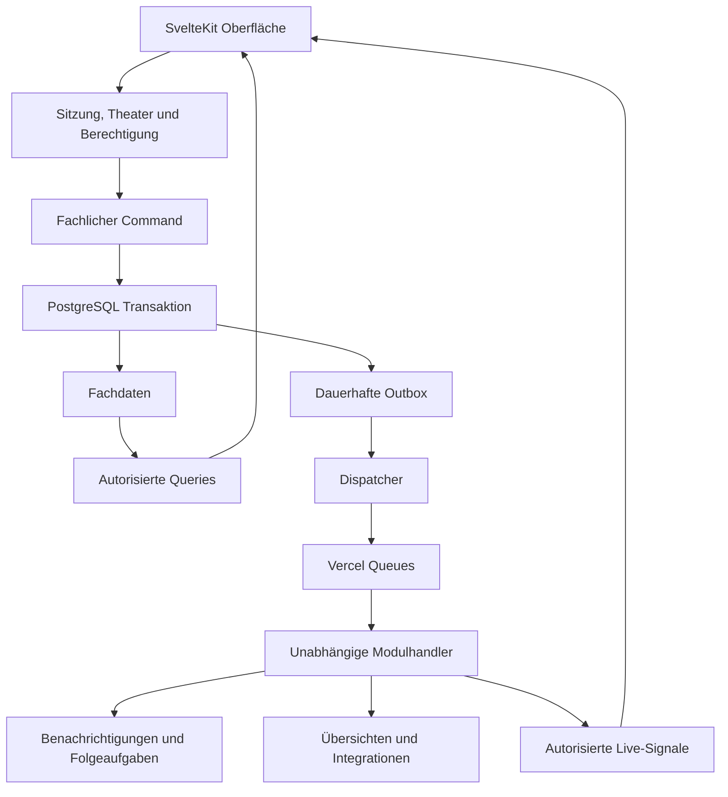

Stand: 10. Oktober 2026. Zur Freigabe vor der Umsetzung.

Showtime soll DigitalMask zu einer Anwendung für den gesamten Theaterbetrieb erweitern. Die Empfehlung ist SvelteKit mit einem modularen Backend, dauerhaft verarbeiteten fachlichen Ereignissen und einer geprüften Trennung aller Theaterdaten. Die vorhandenen Maskenfunktionen und ihre Oberflächen bilden die Referenz; neue Bereiche verwenden dieselben Gestaltungsmittel.

Als Ausgangsbasis ist die lokale DigitalMask-App bestätigt. Ziel ist das bereits angelegte, leere Repository [bthginfo/showtime](https://github.com/bthginfo/showtime). Der untersuchte lokale Quellstand ist `daafd42` auf `codex/digitalmask`. Für Showtime entstehen ein eigener Arbeitsordner, ein eigenes Vercel-Projekt und eigene Datenressourcen. Der vorhandene Vercel-Pro-Plan kann verwendet werden; zusätzliche Ressourcen sollen möglichst kostenlose Tarife nutzen.

Die Freigabe betrifft Architektur, Rollen, den beschriebenen Erstumfang und die Umsetzungsetappen. Anwendungscode, Datenbanken, GitHub-Push und Deployment folgen danach.

## Ausgangsbasis und erforderliche Änderungen

DigitalMask verwendet Next.js, React, TypeScript, eigene CSS-Komponenten und Tailwind, Better Auth, Drizzle, PostgreSQL, privaten Vercel Blob und Upstash Redis. Bereits vorhanden sind Produktionsarbeitsräume, Besetzungen, Maskenpläne, Dienstkalender, Anwesenheit und Arbeitszeiten, Aufgaben, Fundus und Reservierungen, Übergaben, Chats, gemeinsame Dokumente, Exporte und PWA-Funktionen.

Die bestehenden Organisations- und Gewerktabellen, Scope-Fremdschlüssel und die transaktionale Outbox sind eine brauchbare Grundlage. Drei Stellen erfordern einen grundlegenden Umbau:

- Der Sitzungskontext wählt aktuell eine einzelne Mitgliedschaft. Showtime braucht explizite Theater- und Gewerkwechsel sowie mehrere Mitgliedschaften pro Person.

- Rechte folgen bisher weitgehend den drei Rollen User, Admin und Superadmin. Showtime braucht fachliche Berechtigungen mit Theater-, Gewerk- und Produktionsbezug.

- Ein großer Gewerkbestand wird zusammen geladen. Für ein ganzes Theater werden Listen, Kalender und Chats zeitlich begrenzt, nach Bedarf und mit Pagination geladen.

Im untersuchten Schema und in den Migrationen sind keine PostgreSQL-RLS-Policies vorhanden. Die zusätzliche Abschottung auf Datenbankebene wird deshalb neu umgesetzt. Next.js-spezifische Sitzungs-, Cache- und Hintergrundfunktionen werden durch SvelteKit- beziehungsweise Plattformadapter ersetzt.

Der Erstumfang umfasst die aktuell aktiven Funktionen. Früher entfernte Wochenfreigaben für Stunden und ein allgemeiner Änderungsverlauf werden durch die Migration nicht automatisch wieder eingeführt.

## Architektur und Technologiestack

Empfohlen ist ein modularer Monolith: eine Anwendung mit getrennten Fachmodulen, die fachliche Änderungen über definierte Ereignisse austauschen. Das hält Bereitstellung und Betrieb überschaubar. Module können später als eigenständige Dienste betrieben werden, wenn Last oder Integrationen das erfordern.

| Bereich                      | Geplante Technik                                                                              |
| ---------------------------- | --------------------------------------------------------------------------------------------- |
| Oberfläche und HTTP-Eingänge | SvelteKit, Svelte, TypeScript strict und offizieller Vercel-Adapter                           |
| Gestaltung                   | Bestehende CSS-Tokens, Layouts und Assets; Svelte-Komponenten mit derselben Darstellung       |
| Fachlogik                    | Frameworkunabhängige TypeScript-Module mit Commands, Queries und Ereignisverträgen            |
| Datenbank                    | Neues Neon-PostgreSQL-Projekt, Drizzle und versionierte SQL-Migrationen                       |
| Anmeldung                    | Better Auth mit SvelteKit-Integration; eigene Showtime-Sitzungen und Secrets                  |
| Ereignisse                   | Transaktionale PostgreSQL-Outbox und Vercel Queues hinter einem Transportadapter              |
| Dateien                      | Eigener privater Vercel Blob Store                                                            |
| Live-Aktualisierung          | Eigene Upstash-Redis-Ressource, autorisierte SSE-Signale und erneutes Laden betroffener Daten |
| Gemeinsame Dokumente         | Vorhandenes Yjs-Datenformat und Tiptap mit Svelte-Anbindung                                   |
| Prüfung                      | Vitest, PostgreSQL-Integrationstests, Playwright und Screenshotvergleiche                     |
| Bereitstellung               | GitHub, Git-Integration und separates Vercel-Projekt auf dem vorhandenen Pro-Plan             |

SvelteKit hat einen offiziellen Vercel-Adapter; Better Auth und Tiptap dokumentieren Svelte-Anbindungen. Die kompatiblen stabilen Versionen werden zum Umsetzungsbeginn geprüft und im Lockfile festgehalten. [SvelteKit auf Vercel](https://svelte.dev/docs/kit/adapter-vercel), [Better Auth mit SvelteKit](https://better-auth.com/docs/integrations/svelte-kit), [Tiptap mit Svelte](https://tiptap.dev/docs/editor/getting-started/install/svelte).

Ein Fachmodul enthält Domain, Application, Infrastructure und UI. Andere Module verwenden seine öffentlichen Schnittstellen und Ereignisse. Direkte Zugriffe auf interne Tabellen oder Services eines fremden Moduls werden durch Importregeln verhindert.

Ein Modulmanifest beschreibt Kennung, Abhängigkeiten, Berechtigungen, Navigation, Einstellungen, Ereignisse und Schema-Version. Gewerke sind Organisationsbereiche; Module sind Fähigkeiten. Dadurch können etwa Maske, Kostüm und Requisite denselben Fundus- und Reservierungsbaustein verwenden. Ein neues Gewerk lässt sich mit vorhandenen Modulen konfigurieren. Eine neue fachliche Funktion bekommt ein eigenes Modul oder eine klar abgegrenzte Erweiterung.

## Fachliche Ereignisse und Zuverlässigkeit

Ein Command prüft aktuelle Rechte und Geschäftsregeln und schreibt Fachdaten und Ereignis in derselben Datenbanktransaktion. Kritische Ergebnisse wie eine Dienstfreigabe, ein bestätigter Termin oder eine Bestandsreservierung stehen sofort verbindlich fest. Ereignisse starten anschließend Benachrichtigungen, Folgeaufgaben, Übersichten und Integrationen.

| Ereignis                     | Beispiel für eine Folgeaktion                                                      |
| ---------------------------- | ---------------------------------------------------------------------------------- |
| ProductionCreatedV1          | Freigeschaltete Gewerke erhalten ihre Produktionsarbeitsräume                      |
| SchedulePublishedV1          | Betroffene Personen erhalten den veröffentlichten Plan und eine Änderungsübersicht |
| PerformanceRescheduledV1     | Einrichtungspläne werden neu berechnet; betroffene Gewerke erhalten Prüfaufgaben   |
| CastAssignmentChangedV1      | Maske, Kostüm, Ton und Inspizienz prüfen die Auswirkungen der Umbesetzung          |
| DepartmentReadinessChangedV1 | Die Produktionsleitung sieht den aktualisierten Vorbereitungsstand                 |
| ShowReportPublishedV1        | Zuständige Gewerke erhalten die für sie bestimmten Störungen und Aufgaben          |

Beispiel: Die Disposition verschiebt den Vorstellungsbeginn. Der verbindliche Termin wird sofort geändert und auf Konflikte geprüft. Masken- und Umkleidepläne können ihre relativen Zeiten daran ausrichten. Teamleitungen erhalten Hinweise auf notwendige Anpassungen. Bereits veröffentlichte Personaldienste werden dadurch nicht stillschweigend umgeschrieben; dafür ist eine neue planbare und nachvollziehbare Änderung nötig.

Jeder Ereignisvertrag enthält Ereignis-ID, Typ, Schemaversion, Theater-ID, optional Gewerk und Produktion, Aggregat-ID und Version, Zeitpunkt sowie Korrelations-ID. Der Queue-Transport überträgt bevorzugt nur Ereignis-ID, Theater-ID und Schemaversion. Inhalte werden aus der autorisierten Outbox gelesen; Nachrichtentexte, Personalnotizen und Dokumente gehören nicht in Queue-Nachrichten.

Die Verarbeitung muss folgende Eigenschaften haben:

- Mindestens einmal zugestellte Events dürfen keinen doppelten Fachvorgang erzeugen. Jeder Handler verwendet einen eindeutigen Schlüssel aus Theater, Ereignis und Handler; lokale Wirkung und Verarbeitungsbeleg werden gemeinsam gespeichert.

- Externe Schnittstellen erhalten denselben Idempotenzschlüssel, soweit der Anbieter das unterstützt. Eine allgemeine Garantie für genau eine externe Wirkung wird nicht behauptet.

- Reihenfolge wird bei Bedarf je fachlichem Objekt über dessen Version geprüft. Veraltete Ereignisse dürfen aktuelle Pläne nicht zurücksetzen.

- Wiederholungen, Leasing, Fehlerstatus und erneutes Ausführen sind sichtbar. Ein Betriebsbereich zeigt ausstehende und fehlgeschlagene Aufträge ohne fremde Theaterinhalte.

- Ein Recovery-Lauf übernimmt liegengebliebene Outbox-Ereignisse. Mit dem vorhandenen Pro-Plan ist dafür ein minütlicher Ablauf möglich.

- Queue-Ablaufzeiten ersetzen keine dauerhafte Outbox. Nicht abgeschlossene Verarbeitungen bleiben wiederherstellbar.

- Deployments, Schemaänderungen und Rollbacks berücksichtigen noch laufende Ereignisse älterer Versionen.

Vercel Queues ist derzeit Beta, unterstützt unabhängige Consumer und mindestens einmalige Zustellung. Die Kombination aus SvelteKit-Adapter, Consumer-Function und Releaseverhalten wird in der ersten Umsetzungsetappe geprüft. Der Transport bleibt austauschbar. [Vercel Queues](https://vercel.com/docs/queues), [Queues und Deployments](https://vercel.com/docs/queues/concepts), [Cron-Intervalle](https://vercel.com/docs/cron-jobs/usage-and-pricing).

## Trennung der Theaterdaten

Ein Theater ist ein Tenant. Spielstätten, Gewerke, Produktionen und Personen gehören zu diesem Theater. Auch bei Koproduktionen gibt es zunächst keine automatische gemeinsame Datenbasis zwischen Theatern.

Für den Start wird eine neue gemeinsame PostgreSQL-Datenbank mit logisch getrennten Theaterdaten empfohlen. Jede fachliche Tabelle trägt eine verpflichtende `tenant_id`. Das ist ausdrücklich keine physische Datenbank pro Theater.

| Modell                                     | Einordnung                                                                                                                                          |
| ------------------------------------------ | --------------------------------------------------------------------------------------------------------------------------------------------------- |
| Gemeinsame Datenbank mit Tenant-ID und RLS | Empfohlener Start: geringerer Betriebsaufwand, gemeinsame Migrationen und mehrere unabhängige Theater                                               |
| Eigene Datenbank pro Theater               | Stärkere physische Trennung und eigene Wiederherstellung; mehr Aufwand für Provisionierung, Verbindungen und Migrationen                            |
| Mischbetrieb                               | Spätere Option: größere oder vertraglich besonders abgeschottete Theater erhalten eine eigene Datenbank hinter derselben Datenzugriffsschnittstelle |

Die Trennung wird durch mehrere Maßnahmen abgesichert:

1. Der Server bestimmt den aktiven Tenant aus der Route und einer geprüften Mitgliedschaft. Ein übermittelter Tenant-Header oder eine Formular-ID genügt nicht als Zugangsberechtigung.

2. Alle Fachqueries und Schreibvorgänge erhalten einen verpflichtenden Tenant-Kontext.

3. PostgreSQL Row Level Security schützt Tenant-Tabellen zusätzlich. Die Anwendung verwendet eine Rolle ohne Eigentümerrechte und ohne BYPASSRLS; Migrationsrechte bleiben getrennt. Fehlender Kontext bedeutet verweigerten Zugriff.

4. Der Datenbankkontext gilt nur für die aktuelle Transaktion. Eine wiederverwendete Poolverbindung darf keinen Theaterkontext der vorherigen Anfrage behalten.

5. Zusammengesetzte Fremdschlüssel aus Tenant-ID und Objekt-ID verhindern Beziehungen zu Produktionen, Personen, Dateien und Kanälen eines anderen Theaters.

6. Caches und Redis-Schlüssel berücksichtigen Tenant, relevante Berechtigungen und deren Version. Eine Antwort für eine Leitung darf nicht als Antwort für andere Mitglieder wiederverwendet werden.

7. Dateien liegen im privaten Store unter Tenant-Pfaden. Jede Ausgabe prüft zusätzlich den fachlichen Bezug und die aktuellen Zugriffsrechte. Ein Pfadpräfix allein ist kein Zugriffsschutz.

8. Suche, Exporte, ICS-Abonnements, Push-Nachrichten, Dokumenttickets, Hintergrundhandler und Browserdaten erhalten dieselbe Tenant-Grenze.

RLS schützt normale SQL-Zugriffe, aber privilegierte Rollen und Tabellenbesitzer können Policies umgehen. Die Trennung der Datenbankrollen ist deshalb Bestandteil der Umsetzung. [PostgreSQL Row Security](https://www.postgresql.org/docs/current/ddl-rowsecurity.html).

Nur die technische Anmeldeidentität kann theaterübergreifend verwendet werden. Kontaktdaten, Personalprofile, Besetzungen, Verfügbarkeiten, Arbeitszeiten und Rollen bleiben theaterbezogen. Derselbe Mensch kann in Theater A Teamleitung und in Theater B Gast sein. Eine Theaterverwaltung darf dessen globale Anmeldung nicht übernehmen oder das globale Passwort administrativ setzen.

Beim Theaterwechsel werden laufende Anfragen, Live-Verbindungen und Browserzustände getrennt. Lokale Dokumententwürfe verwenden mindestens Tenant-ID, Benutzer-ID und Datei-ID. Private Inhalte werden nicht durch die PWA als gemeinsame Offline-Daten zwischengespeichert.

Neue Theater starten mit neutralen, versionierten Modul- und Gewerkvorlagen. Das Anlegen eines Tenants kopiert keine Personen, Fotos, Nachrichten oder Fachdaten eines bestehenden Theaters. Export und Wiederherstellung erfolgen tenantbezogen; eine Wiederherstellung darf andere Theater nicht überschreiben.

## Rollen und fachliche Berechtigungen

Rollen sind Vorlagen für einzelne Berechtigungen. Entscheidend sind Aktion, Theater, Gewerk, Produktionszuordnung und Schutzklasse des Inhalts. Eine höhere Leitungsrolle erhält dadurch nicht automatisch Zugriff auf alle privaten Inhalte.

| Rolle                       | Zuständigkeit und Standardrechte                                                                                             |
| --------------------------- | ---------------------------------------------------------------------------------------------------------------------------- |
| Mitarbeitende               | Eigene Dienste und Zeiten, Aufgaben und zugängliche Arbeitsräume; Anträge stellen und in freigegebenen Kanälen kommunizieren |
| Teamleitung                 | Planung, Aufgaben, Übergaben und Genehmigungen für die zugewiesenen Gewerke; fachliche Inhalte und Teamübersichten           |
| Produktionsleitung          | Gewerkübergreifende Koordination der zugewiesenen Produktionen, Meilensteine, Abhängigkeiten und Vorbereitungsstände         |
| Disposition und KBB         | Hausweite Termin-, Raum-, Proben- und Besetzungsplanung; Veröffentlichung von Plänen                                         |
| Technische Leitung          | Verantwortung für zugewiesene technische Gewerke, Ressourcen, technische Prüfungen und dokumentierte Freigaben               |
| Intendanz                   | Hausweite Produktions- und Spielzeitübersichten, Budgets, strategische Entscheidungen und definierte Freigaben               |
| Theateradministration       | Mitgliedschaften, erlaubte Rollenvergaben, Gewerkstruktur, Module und Theaterkonfiguration                                   |
| Personalverwaltung          | Gesonderte Rechte für erforderliche Personaldetails, Abwesenheiten und Zeitberichte                                          |
| Gast oder externe Mitarbeit | Zeitlich begrenzter Zugriff auf konkret zugewiesene Produktionen, Termine, Dokumente und Kanäle                              |
| Plattform-Superadmin        | Theater anlegen und sperren, technische Konfiguration, Plattformzustand und bewusst eingereichte Supportanfragen             |

Teamleitung kann mehrere Gewerke umfassen, etwa die Werkstätten. Produktionsleitung und Disposition können als zusätzliche Rollen neben einer Gewerkrolle vergeben werden. Der Plattform-Superadmin und die Theateradministration sind getrennte Rollen.

| Aktion                         | Mitarbeitende         | Teamleitung                   | Disposition                           | Intendanz                               |
| ------------------------------ | --------------------- | ----------------------------- | ------------------------------------- | --------------------------------------- |
| Eigene Zeit buchen             | Ja                    | Ja                            | Ja                                    | Ja                                      |
| Dienste anderer planen         | Nein                  | Eigenes Gewerk                | Mit zugewiesener Planungsberechtigung | Delegierbare Berechtigung               |
| Freiwünsche entscheiden        | Nein                  | Eigenes Gewerk                | Nur bei Zuständigkeit                 | Nur bei Zuständigkeit                   |
| Produktionsinhalte bearbeiten  | Nach Zuweisung        | Eigenes Gewerk                | Planung und Besetzung                 | Zugewiesene fachliche Rechte            |
| Hausplan veröffentlichen       | Nein                  | Nein                          | Ja                                    | Freigabe bei festgelegter Zuständigkeit |
| Private Chats lesen            | Nur als Teilnehmer    | Nur als Teilnehmer            | Nur als Teilnehmer                    | Nur als Teilnehmer                      |
| Sensible Personaldetails lesen | Eigene erlaubte Daten | Erforderlicher Ausschnitt     | Verfügbarkeit für Planung             | Gesonderte Berechtigung                 |
| Rollen vergeben                | Nein                  | Optional begrenzte Teamrechte | Nein                                  | Nur mit Theateradministration           |

Berechtigungen heißen beispielsweise `schedule.publish`, `duty.assign`, `leave.approve`, `production.manage`, `inventory.reserve` oder `budget.approve`. Sie erhalten einen konkreten Scope. Private Chat-Mitgliedschaften und besonders geschützte Dokumente schränken den Zugriff zusätzlich ein.

Eigene Anträge und Ausgaben werden nicht selbst genehmigt. Rollenvergaben dürfen die erlaubten Rechte der vergebenden Person nicht überschreiten. Gäste verlieren mit Ablauf ihrer Zuordnung auch Dokument-, Export- und Kanalzugriff.

Der Plattform-Superadmin bekommt keinen regulären Zugang zu privaten Chats oder Personaldetails. Falls ein Supportzugriff auf Fachdaten benötigt wird, muss er ausdrücklich gewährt, zeitlich begrenzt und protokolliert sein. Die Anwendung bietet dafür keine verdeckte pauschale Lesefunktion.

## Theaterabläufe und gemeinsame Daten

Der typische Produktionsprozess reicht von Konzeption und Planung über Herstellung und Proben bis zu Aufführung und Nachbereitung. Die konkrete Abfolge unterscheidet sich nach Sparte und Haus. Die Anwendung braucht deshalb konfigurierbare Produktionsphasen und mehrere gleichzeitig laufende Produktionen. [Produktionsphasen](https://theaterkompass.de/fachbegriffe/produktion).

Die untersuchten Theaterbeispiele zeigen die Übergänge von Entwurf und Bauprobe über Werkstätten zur Bühnenprobe sowie die parallele Vorbereitung mehrerer technischer und künstlerischer Bereiche. Daraus folgt die Empfehlung, Abhängigkeiten und Übergaben zwischen Gewerken ausdrücklich abzubilden. [Bauprobe und Werkstätten am Staatstheater Nürnberg](https://fundus.staatstheater-nuernberg.de/detail/vom-buehnenbildentwurf-zum-showfuchs-in-sechs-schritten), [Vorbereitung der Endproben am Theater Erfurt](https://www.theater-erfurt.de/aktuelles/probenstart-auf-den-domstufen).

Die vorgesehenen Phasen sind:

1. Spielzeit und Produktion konzipieren: Stück, Rechte, Budgetrahmen, Beteiligte und Spielstätten.

2. Planung und Bauprobe: Termine, Ressourcen, technische Anforderungen und Herstellungsaufträge.

3. Proben und Herstellung: Szenenarbeit, Werkstattfortschritt, Anproben, Masken- und technische Vorbereitung.

4. Endproben: Einrichtung, Durchläufe, Haupt- und Generalprobe mit dokumentierten offenen Punkten.

5. Premiere und Repertoire: wiederkehrende Vorstellungen, Umbesetzungen, Dienste und Vorstellungsberichte.

6. Archiv und Wiederaufnahme: versionierte Unterlagen, Fundusrückgaben, Reparaturen und erneute Vorbereitung.

Eine Generalprobe findet unter Aufführungsbedingungen statt; daraus ergibt sich ein gemeinsamer Vorbereitungsstand für Kostüm, Requisite, Technik und weitere beteiligte Bereiche. [Generalprobe](https://theaterkompass.de/fachbegriffe/generalprobe).

Das Datenmodell unterscheidet Stück, konkrete Produktion, Spielzeit beziehungsweise Wiederaufnahme und einzelne Probe oder Vorstellung. Eine Produktion gehört dem Theater und erhält Arbeitsräume für die beteiligten Gewerke. Der Vorstellungsbeginn wird einmal zentral gespeichert; Maske und Kostüm können relative Einrichtungszeiten darauf beziehen.

Zentrale Beziehungen werden in eigenen relationalen Tabellen modelliert: Mitgliedschaften und Rechte, Produktionen und Besetzungen, Termine, Ressourcen und Reservierungen, Dienste, Arbeitszeiten, Kanäle und Teilnehmer, Dateimetadaten sowie Outbox und Handlerbelege. JSONB bleibt für versionierte Dokumentfelder, Vorlagen und begrenzte Erweiterungen geeignet.

Arbeitszeit und geplanter Dienst bleiben getrennt. Theater haben unterschiedliche Tarifgrundlagen; für künstlerisch Beschäftigte nennt der Bühnenverein unter anderem NV Bühne, TV Gast und TVK. Pausen-, Ruhe- und Dienstregeln werden daher konfigurierbar und vor Verwendung vom Haus fachlich geprüft. Eine ungeprüfte einheitliche Regel für alle Gewerke wird nicht fest eingebaut. [Tarifverträge des Deutschen Bühnenvereins](https://www.buehnenverein.de/de/tarifvertraege).

## Gemeinsame Funktionen des Theaters

- **Hausweite Disposition:** Spielstätten, Probenräume, Produktionen, Besetzungen, Dienste und Ressourcen gemeinsam planen. Personen- und Raumkonflikte berücksichtigen Vor- und Nachbereitung sowie Auf- und Abbau.

- **Veröffentlichte Planstände:** Entwurf, Freigabe und Veröffentlichung unterscheiden. Änderungen an veröffentlichten Plänen bekommen eine neue Version und eine verständliche Änderungsmitteilung.

- **Gewerkübergreifende Aufgaben:** Zuständigkeit, Abhängigkeit, Termin und erforderliche Rückmeldung erfassen. Eine Änderung aus einer Probe kann gezielt an Licht, Ton oder Werkstatt weitergegeben werden.

- **Gemeinsame Dokumentation:** Probenberichte, technische Unterlagen, Aufschriebe, Übergaben und Vorstellungsberichte mit fachlichen Leserechten, Versionsständen und bestehenden Office- und PDF-Funktionen.

- **Ressourcen und Fundus:** Räume, Ausstattung und Materialien reservieren; Mehrfachbelegungen und verfügbare Mengen prüfen. Gemeinsame Ressourcen bleiben von Gewerkbeständen unterscheidbar.

- **Persönlicher Arbeitsraum:** Eigene Dienste, Einsätze, Aufgaben, Zeiten und relevante Mitteilungen anzeigen. Für Mitarbeitende bleibt die tägliche Nutzung übersichtlich.

- **Leitungsübersichten:** Produktionsfortschritt, offene Risiken, Kapazitäten und Budgetrahmen nach Zuständigkeit zusammenfassen. Detailrechte bleiben getrennt.

- **Theaterweite Suche:** Nur erlaubte Produktionen, Personen, Dokumente, Termine und Nachrichten auffindbar machen.

- **SaaS-Verwaltung:** Theater einladen, Module aktivieren, Gewerke konfigurieren, Nutzung und Kontingente verwalten. Ein späteres Abrechnungsmodul kann daran anschließen.

## Geplante Funktionen je Gewerk

Die DTHG beschreibt unter anderem die Arbeitsteilung zwischen Werkstätten, Bühne, Licht, Ton, Kostüm, Maske, künstlerischen Bereichen und Leitung. Diese Tätigkeitsprofile bilden die fachliche Grundlage; die nachfolgenden Softwarefunktionen sind Vorschläge für Showtime. [Berufe am Theater](https://dthgev.de/berufe-am-theater/).

Alle Gewerke erhalten die passenden gemeinsamen Bausteine für Aufgaben, Kalender, Dokumente, Übergaben und Kommunikation. Die Erstfassung ergänzt folgende fachliche Ansichten und Daten:

| Gewerk oder Bereich             | Fachlicher Umfang der Erstfassung                                                                                                                                |
| ------------------------------- | ---------------------------------------------------------------------------------------------------------------------------------------------------------------- |
| Disposition und KBB             | Proben- und Spielplan, Besetzungen, Raumbelegung, Planversionen, Konflikte, Umbesetzungen und Änderungsmitteilungen                                              |
| Regie und Regieassistenz        | Szenenbezogene Probenplanung, Probenberichte, Änderungsaufträge, Aufgabenverteilung und nachvollziehbare Regiebuchstände                                         |
| Dramaturgie                     | Produktionsdossier, Text- und Fassungsstände, Rechercheunterlagen, Rechtefristen, Programmheftaufgaben und redaktionelle Freigaben                               |
| Ensemble und Gäste              | Eigener Proben- und Vorstellungsplan, Besetzungen und Alternativen, Verfügbarkeitsmeldungen, Aufgaben und zugängliche Arbeitsunterlagen                          |
| Inspizienz                      | Versioniertes Ablaufbuch, dokumentierte Cues, Einrichtungschecklisten, Bereitschaft der Gewerke und Vorstellungsberichte                                         |
| Bühnentechnik                   | Auf-, Ab- und Umbaupläne, Personalbedarf, Dekorationsteile, Ressourcenreservierung, Störungen und dokumentierte technische Prüfungen                             |
| Licht                           | Beleuchtungs- und Patchunterlagen, versionierte Cue-Listen, Fokus- und Änderungsaufträge, Ausstattung und Wartungsaufgaben                                       |
| Ton                             | Mikrofon- und Kanalzuordnung, Routingunterlagen, Zuspiel- und Cue-Listen, Aufbauchecklisten und Störungsmeldungen                                                |
| Video und Medien                | Medienverzeichnis mit Versionen, Cue- und Projektionsunterlagen, Rechteangaben und technische Anforderungen                                                      |
| Werkstätten                     | Herstellungsaufträge für Tischlerei, Schlosserei, Malsaal, Plastik und Dekoration; Zeichnungsstände, Materialbedarf, Termine und Übergaben                       |
| Kostüm und Garderobe            | Kostüme je Figur und Besetzung, geschützte Maßdaten, Anproben, Umkleidepläne, Reparaturen, Reinigung und Fundusreservierung                                      |
| Maske                           | Vollständiger aktiver DigitalMask-Umfang einschließlich Aufschrieben, Maskenplänen, Bildern und Perückenfundus; Bezug auf zentrale Besetzungen und Vorstellungen |
| Requisite                       | Szenenbezogene Requisitenlisten, Bereitstellung und Rückstellung, Verbrauchsmaterial, Leihen, Fundus und Reparaturen                                             |
| Chor und Orchester              | Gruppen und Stimmzuordnungen, Proben- und Vorstellungsdienste, Aushilfen, Besetzungen und zugängliche musikalische Unterlagen                                    |
| Ballett und Tanz                | Trainings- und Probenpläne, Besetzungen und Alternativen, Studioreservierung sowie Kostüm- und Ablaufbezug                                                       |
| Vorderhaus und Publikumsservice | Einlass- und Dienstplanung, Veranstaltungsbriefings, Checklisten, organisatorische Besucheranforderungen und Rückmeldungen                                       |
| Presse und Marketing            | Redaktions- und Kampagnenaufgaben, freigegebene Texte und Bilder, Nutzungsrechte, Pressetermine und Veröffentlichungsfreigaben                                   |
| Theaterpädagogik                | Workshops, Raum- und Personalplanung, Produktionsbezüge, Kontaktstellen und pädagogische Materialien                                                             |
| Verwaltung und Einkauf          | Budgetrahmen je Produktion und Gewerk, Bedarfsanträge, Freigaben, Lieferantenkontakte und erforderliche Personalansichten                                        |
| Haustechnik und IT              | Wartungstermine, Räume und Anlagen, Störungs- und Reparaturaufträge, Zuständigkeiten und Übergaben                                                               |

Damit sind alle aufgeführten Bereiche organisatorisch und mit ihren wesentlichen Arbeitsabläufen vertreten. Einige Funktionen nutzen dieselben Module mit unterschiedlichen Vorlagen; eigenständige Fachlogik entsteht dort, wo das nötig ist.

Spätere Vertiefungen sind CAD-Anbindung, direkte Schnittstellen zu Licht- und Tonsoftware, Ticketing, Finanzbuchhaltung, Lohnabrechnung, umfassende Vertragsverwaltung, Tourneeplanung und SaaS-Abrechnung. Showtime verwaltet in der Erstfassung Ablaufunterlagen und Prüfstände; es übernimmt keine Echtzeitsteuerung von Bühnenmaschinen oder Showtechnik. Große Video- und Audioarchive gehören ebenfalls nicht zum kostenlosen Startumfang.

## Hausweite Kommunikation

Global bedeutet für Showtime zunächst theaterweit. Zwischen unterschiedlichen Tenants gibt es keine gemeinsamen Mitarbeiterkanäle und keine gemeinsame Suche in Nachrichten.

| Kanaltyp                         | Zugang                                                                   |
| -------------------------------- | ------------------------------------------------------------------------ |
| Hausmitteilungen                 | Alle aktiven Theatermitglieder; Schreibrecht für definierte Stellen      |
| Gewerkkanal                      | Mitglieder des jeweiligen Gewerks                                        |
| Produktionskanal                 | Berechtigte Beteiligte der Produktion über mehrere Gewerke hinweg        |
| Vorstellungs- oder Probengruppe  | Konkret zugewiesene Beteiligte                                           |
| Arbeitsgruppe                    | Explizit festgelegte Mitglieder, etwa für eine Werkstattabstimmung       |
| Direkt- und privater Gruppenchat | Ausschließlich Teilnehmer                                                |
| Leitungskanal                    | Explizit zugewiesene Leitungspersonen                                    |
| Supportanfrage                   | Bewusst an die Plattform gesendeter Inhalt mit sichtbarem Empfängerkreis |

Vorgesehen sind Erwähnungen, ungelesene Nachrichten, Anhänge, gemeinsame Dokumente und Benachrichtigungseinstellungen. Die Gewerkzuordnung steuert automatische Kanäle; private Gruppen bleiben ausdrücklich mitgliedschaftsbasiert.

Jeder Anhang und jedes darin bearbeitete Dokument erbt die Rechte seines Kanals und fachlichen Bezugs. Eine Rolle in der Theaterverwaltung oder Intendanz ersetzt keine private Chat-Mitgliedschaft. Austritt, Gastablauf und Rechteentzug sperren weitere Abrufe und Dokumentänderungen.

Live-Signale enthalten möglichst nur Änderungsstände. Der Client lädt Inhalte über autorisierte Endpunkte nach. Empfänger von Push-Nachrichten und Erwähnungen werden zum Versandzeitpunkt geprüft. Suchtreffer, Vorschauen und Exporte dürfen keine gesperrten Nachrichtentexte offenlegen.

## Optische und funktionale Übernahme

Die bestehenden Ansichten werden in Svelte umgesetzt und gegen DigitalMask verglichen. Die optische Gleichheit gilt für denselben Inhalt, Zustand, Bildschirm und Darstellungsmodus. Neue Theater- und Gewerkfunktionen brauchen zusätzliche Bedienelemente; diese verwenden die vorhandenen Muster.

Vor der Portierung wird eine Referenzmatrix erstellt: Anmeldung, Heute, Produktionsübersicht und Reiter, Kalender und Teamraster, Aufgaben, Zeiten, Chat, Kataloge, Dokumente und Editoren, Fundus, Übergaben, Exporte, Hilfe und Einstellungen.

Die Referenz umfasst:

- Light, Dark, System und die vorhandenen persönlichen Akzentfarben.

- Desktop, Tablet und Smartphone, einschließlich der mobilen Navigation.

- Tabellen, Dialoge, Dropdowns, Formulare, Fehler-, Lade- und Leerzustände.

- Kalenderdichte, Maskenraster, Drag-and-drop und alternative Bedienwege.

- Schrift, Icons, Abstände, Radien, Farben und Bildausschnitte.

- Scrollpositionen, Rücknavigation, Filter und ungespeicherte Entwürfe.

- Dokumentbearbeitung und die vorhandenen Druck- und Exportlayouts.

Screenshots verwenden identische synthetische Daten und fixierte Uhrzeiten. Dynamische Stellen werden einzeln behandelt; großflächige Screenshot-Ausnahmen dürfen keine Layoutabweichungen verstecken. Eine Ansicht wird erst nach Vergleich von Darstellung und Bedienung als übernommen gewertet.

FullCalendar kann über seine frameworkunabhängige API eingebunden werden. Für die Übernahme wird zunächst die zur aktuellen Darstellung passende Version verwendet; der Wechsel auf eine neu gestaltete Kalendergeneration ist kein notwendiger Teil der Svelte-Migration. Kostenpflichtige Ressourcenansichten sind nicht vorausgesetzt. [FullCalendar ohne Framework](https://fullcalendar.io/docs/vanilla-js).

React-Komponenten werden portiert. React-spezifisches Drag-and-drop bekommt eine Svelte-kompatible Umsetzung mit Maus, Touch, Tastatur und den bestehenden Alternativaktionen. Frameworkunabhängige Regeln, Validierung, Yjs-Schema und Exportlogik werden nach Prüfung wiederverwendet.

Die bestehenden React-PDF-Renderer können zunächst isoliert auf dem Server bleiben, um Drucklayouts zu erhalten. Sie sind kein Teil des Svelte-Frontends. Eine spätere Entfernung dieser serverseitigen Bibliothek ist unabhängig von der Frontendmigration möglich.

Die Umbenennung in Showtime und die notwendigen Theater- und Gewerkselektoren werden als konkrete Erweiterungen der Referenz erfasst. Die neue Navigation verwendet die vorhandenen Gruppen und zeigt nur die für die Person relevanten Module.

## Neue Infrastruktur und Kostenrahmen

Showtime erhält eigene Ressourcen, die ausschließlich mit dem neuen Projekt verbunden werden:

| Ressource         | Geplante Trennung                                                                              |
| ----------------- | ---------------------------------------------------------------------------------------------- |
| GitHub            | Vorhandenes Ziel-Repo showtime, eigener Hauptbranch und Implementierungsbranches               |
| Vercel            | Neues Projekt showtime auf dem vorhandenen Pro-Konto, eigene URL und Projektkonfiguration      |
| PostgreSQL        | Neues Neon-Projekt; getrennte Datenbanken oder Branches für Anwendung, Entwicklung und Preview |
| Dateien           | Eigene private Stores für Anwendungs- und Testdateien                                          |
| Redis             | Eigene Showtime-Ressource; Umgebungs- und Tenant-Namensräume                                   |
| Events            | Getrennte Queue-Kontexte und Outbox-Daten für Preview und Anwendung                            |
| Authentifizierung | Neue Secrets, Cookie-Konfiguration, Sitzungen und Bootstrap-Zugänge                            |
| CI                | Prüfungen ohne Produktionscredentials; Migrationen nur gegen das ausdrücklich bestimmte Ziel   |

Preview- und Entwicklungsdaten entstehen synthetisch. Auch ein Neon-Preview-Branch darf nicht ungeprüft aus einer Datenbank mit realen Personal- oder Chatdaten abgezweigt werden. Ein eigener Branch allein anonymisiert keine Daten.

Kostenstand der geprüften Quellen:

- Neon nennt seit dem 2. Oktober 2026 für Free 1 GB Datenbankspeicher und 100 CU-Stunden pro Projekt und Monat. Welcher Tarif bei der Marketplace-Provisionierung konkret zugewiesen wird, wird vor Erstellung geprüft. [Neon Free](https://neon.com/blog/neon-free-plan-1-gb-per-project).

- Upstash Redis nennt 250 MB Daten und 500.000 Commands pro Monat im Free Tier. Live-Verbindungen, Dokumentbearbeitung und Fan-out müssen daran gemessen werden. [Upstash Redis Free](https://upstash.com/pricing/redis).

- Vercel Queues läuft auf allen Plänen, ist Beta und wird nach Operationen abgerechnet. Die veröffentlichte Million kostenloser Operationen bezieht sich auf Hobby; für Pro gilt die dort dokumentierte nutzungsbasierte Abrechnung. Consumer-Functions verbrauchen zusätzlich Compute. [Queue-Preise](https://vercel.com/docs/queues/pricing).

- Private Dateien benötigen einen privaten Store und eine autorisierte Ausgabe. Neue Stores, Transfer und Live-Functions werden gegen die Kontingente des vorhandenen Pro-Kontos geprüft. [Vercel Blob](https://vercel.com/docs/vercel-blob).

Ziel sind kostenlose Datenressourcen und Nutzung innerhalb der vorhandenen Pro-Kontingente. Ein zusätzlicher dauerhaft kostenloser Betrieb des ganzen Theaters kann daraus nicht garantiert werden. Kontingente können mit anderen Projekten desselben Kontos geteilt sein. Es wird kein weiteres kostenpflichtiges Abonnement und kein Tarifupgrade ohne gesonderte Freigabe eingerichtet.

Die bestehenden Betriebsunterlagen nennen ein Pro-Zielkonto; die aktuell verfügbare Vercel-Verbindung hat dessen Teamzugang nicht bestätigt. Vor Provisionierung wird die Verbindung zum vom Nutzer bestätigten Pro-Konto geprüft.

Caches, Pagination, zusammengefasste Live-Signale und fehlende SQL-Heartbeat-Abfragen begrenzen Verbrauch. Pro Tenant werden Speicher, Uploads und aufwendige Aktionen begrenzt, damit ein einzelnes Theater das gemeinsame Kontingent nicht unkontrolliert erschöpft.

Vercel Queues garantiert aktuell keine strikte Bindung an eine Region während eines regionalen Failovers. Personeninhalte bleiben deshalb außerhalb des Queue-Transports. Bei vertraglich vorgeschriebener strikter Datenresidenz muss ein dazu passender Transport gewählt werden. [Queue-Regionen](https://vercel.com/docs/queues/concepts).

Die Erstinstallation übernimmt Code und neutral konfigurierte Vorlagen. Echte DigitalMask-Daten und Dateien werden nicht automatisch kopiert. Falls sie übernommen werden sollen, folgt ein eigener Import mit ID-Zuordnung, Dateikopie, Rechteprüfung und Mengenabgleich. Auth-Secrets und Sitzungen werden nicht übernommen.

Backups umfassen Datenbank und private Dateien. Eine tenantbezogene Wiederherstellung wird in einer isolierten Umgebung geprobt. Releases verwenden kompatible Migrationen und einen geprüften Build; ein Anwendungsrollback ersetzt keinen Datenbankrollback.

## Umsetzung nach Freigabe

Die Etappen bilden zusammen den vorgesehenen Erstumfang. Sie erlauben überprüfbare Zwischenstände; der Auftrag endet mit der getesteten, separat bereitgestellten Anwendung.

| Etappe                            | Ergebnis und Abschlusskriterium                                                                                                                                                                                  |
| --------------------------------- | ---------------------------------------------------------------------------------------------------------------------------------------------------------------------------------------------------------------- |
| 0 Referenz und technische Prüfung | Quellstand fixieren, Oberflächen- und Funktionsmatrix erstellen, neues Zielkonto prüfen, kostenlose Ressourcen bereitstellen und SvelteKit mit Auth, privater Datei, RLS und Queue-Consumer durchgängig erproben |
| 1 Plattform und Mandanten         | Theater, Gewerke, Mitgliedschaften, Rollen, RLS, Tenant-Kontext, Modulmanifest und Outbox umsetzen; zwei Testtheater bleiben in Datenbank und API getrennt                                                       |
| 2 Übernahme von DigitalMask       | Aktiven Maskenumfang vollständig nach Svelte portieren; Referenzscreens, Kalender, Maskenpläne, Office-Dokumente, Export und mobile Bedienung vergleichen                                                        |
| 3 Gemeinsamer Theaterbetrieb      | Produktionen und Besetzungen zentralisieren, Hausdisposition, Planveröffentlichung, gewerkübergreifende Aufgaben und theaterweite Kommunikation integrieren                                                      |
| 4 Gewerke und Fachabläufe         | Die beschriebenen Fachansichten, Vorlagen und notwendigen Datenmodelle für alle Bereiche ergänzen; eine Produktion von Planung bis Vorstellungsbericht durchspielen                                              |
| 5 Abnahme und Bereitstellung      | Rechte- und Isolationstests, Event-Fehlerfälle, Oberflächenvergleich, Verbrauchsmessung und Restore prüfen; Code in showtime veröffentlichen und den geprüften Build separat auf Vercel bereitstellen            |

Nach Freigabe erfolgen die notwendigen Schritte eigenständig innerhalb dieses Umfangs. Änderungen am Umfang, kostenpflichtige neue Tarife und ein Import realer Altdaten werden separat behandelt.

Der Umbau ist mehr als ein Austausch des Frontendframeworks. Besonders aufwendig sind die vollständige Übernahme der interaktiven Ansichten, die zentralisierte Planung und die Rechteprüfung über alle Dateiformate und Live-Funktionen. Ein belastbarer Zeitrahmen ergibt sich aus der Referenzmatrix und dem technischen Durchlauf der ersten Etappe.

## Abnahmekriterien und Freigabeumfang

Die Anwendung gilt erst als fertig, wenn insbesondere folgende Fälle nachweisbar funktionieren:

1. Theater A kann weder über erratene IDs noch über Suche, Caches, Exporte, ICS, Dateien, Chat, Push oder Events Daten von Theater B lesen oder ändern.

2. RLS verweigert Queries ohne gültigen Tenant-Kontext. Nach Pool-Wiederverwendung von A nach B bleiben nur die jeweils erlaubten Zeilen sichtbar.

3. Eine Person mit unterschiedlichen Rollen in zwei Theatern erhält die Rechte des gewählten Kontexts. Gewerk- und Produktionsgrenzen gelten auch innerhalb eines Theaters.

4. Theaterverwaltung, Intendanz und Plattform-Superadmin erhalten keinen privaten Chat-Zugriff allein durch ihre Rolle.

5. Rechteentzug und Gastablauf sperren weitere Zugriffe, alte Dateitickets und neue Dokumentänderungen. Vorher rechtmäßig heruntergeladene Inhalte lassen sich nicht nachträglich aus dem Besitz einer Person entfernen.

6. Doppelte und verspätete Events, Consumer-Abbruch und ein Fehler zwischen Datenbankcommit und Queue-Versand erzeugen keine doppelten Fachvorgänge; Recovery arbeitet ausstehende Vorgänge auf.

7. Veraltete Events und Browserentwürfe überschreiben keine neueren Plan- oder Dokumentstände. Fehler bleiben sichtbar und kontrolliert wiederholbar.

8. Ein veröffentlichter Terminplan und eine Umbesetzung erreichen die zuständigen Gewerke. Persönliche Dienste und tatsächlich gebuchte Zeiten bleiben fachlich getrennt.

9. Bestehende Maskenansichten stimmen in den festgelegten Referenzzuständen visuell und funktional überein. Neue Module verwenden dieselben Komponenten und Gestaltungsregeln.

10. Entwicklung und Preview schreiben ausschließlich in ihre eigenen Datenressourcen. Keine Showtime-Operation verändert die bestehende DigitalMask-Installation.

11. Listen und Chats sind paginiert, Kalender werden zeitlich begrenzt geladen, und synthetische Daten für ein ganzes Theater werden mit gemessenem Ressourcenverbrauch verarbeitet.

12. GitHub-Stand, Deployment, Migrationen, Betriebsanleitung und Wiederherstellungsweg sind nachvollziehbar; der veröffentlichte Build besteht Login, Planung, private Datei, Chat, Dokumentbearbeitung und Export.

Zur Freigabe vorgeschlagen sind: SvelteKit, der modulare Aufbau mit dauerhaft verarbeiteten Events, logisch getrennte Tenant-Daten mit RLS, das Rollenmodell, die vollständige Übernahme des aktuellen Maskenumfangs, alle beschriebenen Funktionen der Erstfassung und die separate Bereitstellung auf dem vorhandenen Pro-Plan mit möglichst kostenlosen neuen Datenressourcen.

Die zentrale Alternative ist eine physisch eigene Datenbank pro Theater schon ab dem Start. Wenn diese Trennung gewünscht ist, muss sie vor der Umsetzung im Plan ersetzt werden; eine bloße Tenant-ID im gemeinsamen Datenbestand ist damit nicht gleichzusetzen.
