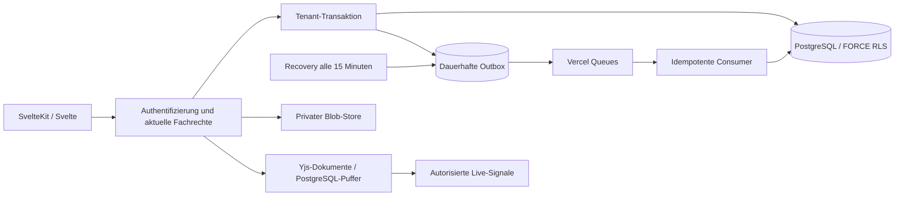

# Showtime: Architektur und Rechte

Stand: 11. Oktober 2026. Der freigegebene fachliche Umfang und die Recherche stehen in [APPROVED-PLAN.md](APPROVED-PLAN.md) und [GEWERKE-ABLAEUFE.md](GEWERKE-ABLAEUFE.md). DigitalMask, Quellstand `daafd42`, ist die historische Referenz. Showtime besitzt eigene Ressourcen. Auf ausdrücklichen Auftrag wurden die vorhandenen DigitalMask-Daten als getrennte Kopie in den Tenant Stadttheater Ingolstadt übernommen; die Quelle wurde nicht verändert.

## Aufbau

SvelteKit und Svelte 5 bilden die Oberfläche und HTTP-Eingänge. Die bestehenden CSS-Tokens, Kalender-, Masken-, Office- und Fundusansichten wurden übernommen. React wird ausschließlich für serverseitige PDF-Dokumente verwendet. Es gibt kein Next.js-Frontend und keinen parallelen Next.js-Server.

`src/routes` enthält SvelteKit-Eingänge, `src/modules` die Fachmodule, `src/platform` Auth, DB-Kontext, Rechte, Events und Infrastruktur. Gemeinsame Verträge und Rechtehilfen liegen in `src/shared`. Der modulare Monolith hält verbindliche Geschäftsentscheidungen in einer Transaktion; spätere Folgen laufen über Ereignisse. Der Queue-Transport lässt sich ersetzen, ohne die Fachmodule neu aufzubauen.

## Trennung der Theater

Ein Theater entspricht `organizations.id`. Jede Fachtabelle enthält eine verpflichtende `organization_id`; gemeinsame Tabellen sind ausschließlich Identitäts- und Plattformmetadaten. Mehrere Theater teilen sich innerhalb einer Umgebung dieselbe Datenbank, ihre Daten sind logisch getrennt. Entwicklung, Preview und Produktion verwenden zusätzlich physisch getrennte Neon-Projekte und private Blob-Stores.

Die API ermittelt Theater, Gewerk, Mitgliedschaft und aktuelle Grants aus der authentifizierten Sitzung. Ein übermittelter Kontext wird erst nach Prüfung akzeptiert. `tenantTransaction` setzt Tenant, Person und Gewerk transaktionslokal. Die DB-Fassade verweigert ungebundene Fachqueries. Ein HTTP-Fehler rollt Fachänderung und Outbox zurück. Poolverbindungen behalten keinen Kontext für die nächste Anfrage.

Alle fachlichen Tabellen verwenden `FORCE ROW LEVEL SECURITY`. Zusammengesetzte Fremdschlüssel verbinden Tenant und Objekt-ID, auch für Produktionen, Elternobjekte, Dokumente, Historien und Events. Laufzeitrollen sind weder Tabellenbesitzer noch Superuser und besitzen kein `BYPASSRLS`.

| Datenbankrolle     | Aufgabe                                                                              |
| ------------------ | ------------------------------------------------------------------------------------ |
| `showtime_app`     | Fachoperationen ausschließlich im überprüften Tenant-Kontext                         |
| `showtime_auth`    | Identitäten, Zugangsdaten, Sitzungen und Plattformadmin-Zuordnung                    |
| `showtime_control` | Theater, Mitgliedschaften, Grants, Module und ausdrücklich übermittelte Supportfälle |
| `showtime_worker`  | Tenantgebundene Ereignisse und kontrollierte Betriebsaktionen                        |
| Eigentümerrolle    | Ausschließlich lokale Migration und Provisionierung; nicht im Deployment             |

Caches, Cursor, Browserablagen, ICS-Zugänge, Dokumenttickets und Dateiausgabe berücksichtigen den Tenant und relevante Zugriffsrechte. Private Dateien liegen unter Tenant-Präfixen; jede Ausgabe prüft zusätzlich ihren fachlichen Elternbezug. Alte Tickets ersetzen keine erneute Berechtigungsprüfung. Entzug, Ablauf und Theatersperren wirken bei der nächsten Anfrage.

## Rollen und Reichweite

Eine Person kann mehrere Grants haben. Jeder Grant gilt für ein Theater, ein Gewerk oder eine Produktion und kann ablaufen. Rollen sind Vorlagen für explizite Aktionen. `src/platform/access.ts` ist die verbindliche Berechtigungsmatrix; die Oberfläche blendet Aktionen anhand derselben Regeln ein.

| Rolle                 | Wesentliche Rechte                                                                                |
| --------------------- | ------------------------------------------------------------------------------------------------- |
| Mitarbeitende         | Eigene Zeiten, Freiwünsche und Verfügbarkeiten; erlaubte Aufgaben, Unterlagen und Kommunikation   |
| Teamleitung           | Zusätzlich Aufgabenverteilung, Gewerkplanung, Fundus, Bereitschaft und ausdrücklich Teamzeiten    |
| Produktionsleitung    | Produktion, Besetzung, koordinierende Planung, Aufgaben und Budgetübersicht im vergebenen Kontext |
| Disposition           | Besetzung, Planung, Konfliktprüfung und Planveröffentlichung                                      |
| Technische Leitung    | Technische Aufgaben, Unterlagen, Ressourcen und Bereitschaft                                      |
| Intendanz             | Produktions- und Planübersicht, Bereitschaft und Budgetfreigaben                                  |
| Theateradministration | Mitglieder, Einladungen, Rollen, Module, Kontingente und Audit                                    |
| Personalverwaltung    | Berechtigte Personalansichten, Teamzeiten und Freiwünsche                                         |
| Kostüm-Fachrolle      | Zusätzlich geschützte Maßdaten im vergebenen Kontext                                              |
| Gast                  | Befristeter Produktionszugang für erlaubte Pläne, Unterlagen und Kommunikation                    |
| Plattform-Superadmin  | Theater anlegen/sperren und ausdrücklich eingereichten Support bearbeiten                         |

Die Plattformrolle ist separat und verleiht keine privaten Fachrechte. Auch Theateradministration und Intendanz erhalten keine privaten Chats allein durch ihre Rolle. Der Bootstrap-Zugang besitzt zusätzliche, ausdrücklich gespeicherte Theaterrollen für die Erstkonfiguration.

Eigene Arbeits- und Anwesenheitsbuchungen lassen sich unabhängig von ihrer Erfassungsart ändern und löschen. Das gilt auch nach Entzug des Zugangs zur ursprünglichen Produktion, solange die unveränderte historische Referenz erhalten bleibt. Fremde Zeiten erfordern `time.team.manage`. Versionsprüfung und Idempotenzschlüssel verhindern verlorene Korrekturen und doppelte Buchungen.

## Theaterkern und Gewerke

Zentrale Produktionen verknüpfen Werke, Spielzeiten, Vorstellungsserien, Besetzungen und kanonische Kalendertermine. Raum- und Ressourcenbelegung berücksichtigt Mengen, Kapazität, Auf- und Abbau. Planung prüft Personen- und Besetzungskonflikte sowie vom Theater bestätigte Arbeitsregeln. Diese Einstellungen ersetzen keine tarifliche oder arbeitsrechtliche Bewertung.

Planstände durchlaufen Entwurf, Freigabe und Veröffentlichung. Eine zwischenzeitlich geänderte Planung macht einen alten Entwurf ungültig. Freigaben gelten für einen konkreten Snapshot. Bereitschaft und Abhängigkeiten sperren definierte Produktionsschritte. Bedarfsanträge sind an veröffentlichte Budgetrahmen gebunden; eigene Anträge dürfen nicht selbst genehmigt werden, und genehmigte Ausgaben dürfen den Rahmen nicht überschreiten.

`src/modules/theater/registry.ts` enthält zwanzig typisierte Gewerke mit Feldern, Fachrechten, Abhängigkeiten und Ereignissen: Disposition, Regie, Dramaturgie, Ensemble, Inspizienz, Bühne, Licht, Ton, Video, Werkstätten, Kostüm, Maske, Requisite, Chor/Orchester, Tanz, Vorderhaus, Marketing, Theaterpädagogik, Verwaltung sowie Haustechnik/IT. Gemeinsame Aufgaben-, Kalender-, Ressourcen-, Dokument- und Chatdienste werden wiederverwendet. Neue Gewerke benötigen einen Manifest-Eintrag, Aktivierung und Rechtezuordnung; neue Geschäftsregeln gehören in einen Fachservice mit passenden Ereignissen.

Hauskanäle, Gewerk- und Produktionskanäle bleiben tenantgebunden. Private Gruppen und Direktchats erfordern ausdrückliche Teilnahme. Suche und Exporte verwenden nur aktuell erlaubte Daten. Plattform-Support bekommt ausschließlich die bewusst weitergeleiteten Felder Titel, Beschreibung und Typ einer eigenen Rückmeldung; Anhänge und sonstige Theaterdaten werden nicht mitgesendet.

## Ereignisse und Dokumente

Jeder Command speichert die verbindliche Änderung und sein Ereignis gemeinsam. Die Queue erhält nur einen HMAC-signierten Zeiger aus Ereignis-ID, Tenant und Schemaversion. Private Inhalte bleiben in der autorisierten Outbox. Der separate SvelteKit-Consumer ist regional in Frankfurt eingerichtet.

Handler speichern Wirkung und Verarbeitungsbeleg zusammen. Eindeutige Tenant-/Event-/Handler-Schlüssel machen doppelte und nach Unterbrechung wiederholte Zustellung sicher. Projektionen beachten Aggregatversionen. Leasing, Wiederholungen und Fehlerstatus bleiben dauerhaft sichtbar. Die Theaterverwaltung kann fehlgeschlagene Events nach Behebung der Ursache erneut starten. Recovery verarbeitet liegengebliebene Events tenantweise und mit begrenzten Batches.

Yjs-Dokumentzustände, Updates und Zwischenpuffer liegen dauerhaft in PostgreSQL. Live-Signale verwenden im Startbetrieb autorisierte SSE-Verbindungen mit einer Fünf-Sekunden-Prüfung; aktuelle Inhalte kommen über erneut autorisierte APIs. Hintergrundtabs pausieren. Ein Redis-Adapter ist vorbereitet, aber kein zusätzliches Redis-Abonnement wurde gebucht. Office- und PDF-Ausgabe berücksichtigen dieselben Elternrechte.
